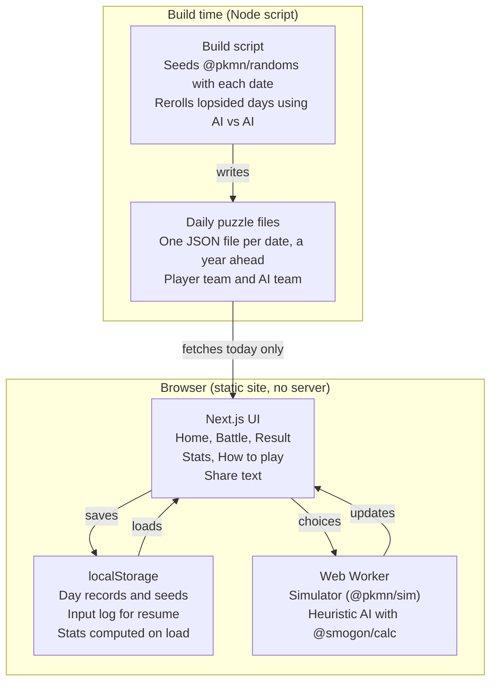

# Showdol — Build Plan

_Last updated: Nov 24, 2026_

## Concept

Showdol is a daily Pokémon battle: one Gen 9 Random Battle (S/V singles) a day against an AI, with the same two teams for every player, then stats and a shareable result like Wordle.

- **One game a day.** Each local calendar day is a numbered puzzle (#1, #2, …). After you play, the site shows your result and counts down to local midnight.
- **Same puzzle for everyone.** Every player gets the same Random Battle team and faces the same AI team, hidden until revealed in battle.
- **Your own luck.** Damage rolls, crits and misses are rolled separately for each player, so no one can post a winning move sequence.
- **No accounts, no backend.** Everything runs in the browser and stats live in localStorage. Nothing connects to Pokémon Showdown's servers.

### Decisions made

| Question | Decision |
| --- | --- |
| Opponent | Heuristic AI, beatable but not free |
| AI information | Sees the player's full team |
| Sets | Gen 9 Random Battle sets |
| Teams | Same player team and same AI team for everyone each day |
| Luck | Separate battle rolls for each player |
| Stats | Browser only (localStorage) |
| Sign-in | None |
| Daily reset | Local midnight, device clock, honor system |
| Hosting | Static site (Vercel or any static host) |

## Architecture

Showdol is a fully static Next.js site. The battle engine and the AI run in a Web Worker in the player's browser, so there is no server to run.

| Part | Choice | Notes |
| --- | --- | --- |
| Framework | Next.js (App Router) + TypeScript | Static export, mobile-first |
| Battle engine | `@pkmn/sim` (or the `pokemon-showdown` package) | Showdown's MIT-licensed simulator, in a Web Worker |
| Team generation | `@pkmn/randoms` | Gen 9 Random Battle generator, run at build time |
| Protocol and state | `@pkmn/protocol` + `@pkmn/client` | Turn engine output into state the UI draws |
| AI damage math | `@smogon/calc` | Expected damage and KO odds for the heuristic AI |
| UI | Custom React components | No code from Showdown's AGPL client |
| Storage | localStorage | One versioned key per player |
| Hosting | Vercel or any static host | No long-running process needed |

**Licensing:** the simulator and the pkmn libraries are MIT. Building our own battle UI avoids the AGPLv3 license on Showdown's official client.



The build script makes every day's teams ahead of time. In the browser, the UI fetches only today's file, hands it to the worker, and saves each choice so the game can resume.

## Daily puzzle

Daily teams are generated at build time, not in the browser, so a given day's teams never change after launch.

- **Puzzle number** = days since the launch date, counted by the player's local date. Like Wordle, players in different time zones reach puzzle #N at different moments.
- **Build script:** for each date, seed `@pkmn/randoms` with the date, generate the player team and the AI team, and write one small JSON file per date (for example `/puzzles/2026-12-01.json`). Generate a year ahead.
- **Why build time:** a simulator or randoms update would silently change every team for a given seed if teams were generated at runtime.
- **Curation:** the script runs several hundred AI-vs-AI battles per matchup and rerolls badly lopsided days (for example, one side winning more than about 80%). The threshold is tuned in Phase 3.
- **Loading:** the browser fetches only today's file.
- **Honor system:** a curious player could fetch tomorrow's file or read the AI team in dev tools. That's accepted for this audience.
- **Dependency pinning:** pin the sim and randoms versions. Upgrading them only affects days not yet generated.

## Luck and resume

Each game gets its own random battle seed when it starts, and every choice is saved as it's made, so reloading resumes the exact same battle.

- **Battle seed:** created once at game start and stored with the day's record. It controls damage rolls, crits, misses and secondary effects.
- **Input log:** every player choice (and the AI's) is appended to storage as it happens.
- **Resume:** on reload, the worker restarts the simulator with the same seed and replays the input log to the current turn.
- **No rerolling luck:** because the seed is fixed, refreshing after a bad crit replays the same crit. A closed tab can be resumed later the same day.
- **AI randomness:** the AI's small random factor uses its own seed, also stored, so the AI's replayed choices match exactly.

## AI opponent

The AI is a heuristic bot: each turn it scores every legal option and picks the best, with a small random factor so it's harder to exploit.

1. **Attacking:** score each move by expected damage (`@smogon/calc`), knockout chance, accuracy, recoil, and immunities or abilities that block it.
2. **Speed check:** if the player's active Pokémon is faster and can knock out the AI's, weigh switching or a priority move.
3. **Switching:** when threatened or badly outmatched, switch to the teammate that best takes the hit and threatens back.
4. **Utility:** set hazards early, recover at low HP, use status moves on good targets, and use setup moves when it's safe.
5. **Terastallizing:** one simple rule. Tera when it flips a knockout either way.
6. **Pick:** take the highest score, with a small seeded random chance of the second-best option.

**Information:** v1 lets the AI see the player's full team, which is simpler and slightly harder to beat. A later version can limit it to revealed information plus likely Random Battle sets.

**Test harness (offline, Node):**

- AI vs a random-move bot: target a win rate near 100%.
- AI vs AI on each day's matchup: feeds the lopsided-day filter.
- Playtests with friends to tune the score weights.

## Screens and game flow

The game has five screens. A day's visit runs Home, then Battle, then Result.

| Screen | What it shows |
| --- | --- |
| Home | Today's puzzle number, with Play, Resume, or a countdown if already played |
| Battle | Both active Pokémon, HP bars, move and switch buttons, Tera toggle, battle log, forfeit |
| Result | Win or loss, turns, Pokémon left, the AI's full team revealed, share button, countdown |
| Stats | Played, win %, current and best streak, distribution of results |
| How to play | Short rules and what the share squares mean |

- **Team view:** Random Battle has no team preview. You see your own six before the battle. The AI's team is hidden until each Pokémon appears.
- **Stats distribution:** Wordle-style bars for Loss and for wins with 1, 2, 3, 4, 5, or 6 Pokémon left.
- **Mobile first:** move and switch buttons sized for thumbs. The log can collapse.

## Daily lock rules

Each date's game moves one way through three states: not started, in progress, finished.

- **Date key:** the player's local date (`YYYY-MM-DD`) from the device clock. The reset happens at local midnight.
- **Starting:** pressing Play creates the day's record and the battle seed. From then on, the day counts.
- **Midnight mid-game:** a game belongs to the date it started on. Finishing after midnight still records it for that date, and the new day unlocks right after.
- **Forfeit:** counts as a loss.
- **Abandoned game:** a game still in progress the next day can be finished until local midnight of that next day. After that it's recorded as a loss.
- **Missed days:** they break the streak but aren't recorded as losses.
- **Clock changes:** honor system. Changing the device clock can unlock another day, and that's accepted.
- **Streak:** consecutive puzzle numbers won. Current streak resets on a loss or a missed day.

## Data model

All state lives under one localStorage key, `showdol:v1`, holding a schema version, settings, and one record per date. Stats are computed from the records and never stored, so they can't drift.

| Field | Type | Notes |
| --- | --- | --- |
| `schemaVersion` | number | Starts at 1; migrations run on load |
| `settings` | object | Animations on/off, log expanded, theme |
| `games[dateKey]` | object | One record per local date |
| → `puzzleNumber` | number | Days since launch |
| → `status` | `in_progress` \| `won` \| `lost` | Set to won/lost on finish |
| → `battleSeed` | string | Fixed at game start |
| → `aiSeed` | string | For the AI's random factor |
| → `inputLog` | string[] | Every choice, for replay and resume |
| → `turns` | number | Final turn count |
| → `myFainted` | boolean[6] | In team order, for the share squares |
| → `aiRemaining` | number | Opposing Pokémon left on a loss |
| → `forfeited` | boolean | True if the loss came from a forfeit |
| → `startedAt`, `finishedAt` | ISO string | Local timestamps |

**Export/import:** a copyable code (the JSON, compressed and base64-encoded) so stats can move to another device without a backend.

## Share format

The share text shows the puzzle, the result and your six Pokémon as squares, with no names, so it spoils nothing.

```text
Showdol #12 · W in 23 turns
🟩🟩⬛🟩⬛⬛
showdol.example
```

- **Squares:** your six in team order. Green = still standing at the end, black = fainted.
- **Loss line:** `Showdol #12 · L in 31 turns (2 left)`, where the number is the AI's Pokémon remaining. Forfeits read `L (forfeit)`.
- **Sharing:** the Web Share API on mobile (opens the phone's share sheet), clipboard copy on desktop, with a "Copied" toast.
- **Link:** the site's domain, once chosen.

## Risks and spikes

Five unknowns get tested early, most in Phase 0, before any UI work.

| Risk | What could go wrong | Spike or fallback |
| --- | --- | --- |
| Sim in the browser | Bundle too large, or Node-only imports break in a Web Worker | Load the worker lazily after Play. Fallback: trim to Gen 9 data only |
| Team generation | `@pkmn/randoms` output not stable or hard to seed | Build script generates and saves teams, so runtime never depends on it |
| AI quality | Too easy, or exploitable by one repeated trick | Harness plus playtests in Phase 3. Tune weights, add randomness |
| Sprites and IP | Linking to Showdown's sprite server is fragile, and Nintendo/The Pokémon Company own the IP | Self-host a sprite set with a clear license. Non-commercial fan project, no official logos |
| Mobile performance | Simulator plus AI stalls low-end phones | Everything in the worker, with a time budget per AI turn |

## Build phases

The build runs in six phases. Each ends with something playable, and the risky parts come first.

### Phase 0: Spikes

- [x] Next.js + TypeScript project with static export
- [x] Simulator running in a Web Worker in the built site
- [x] Build script generates a seeded Gen 9 Random Battle matchup with `@pkmn/randoms`
- [x] Random-move bot vs random-move bot battle finishes in the console
- [x] Measure the worker bundle size and load time (phone timing deferred until there's a deployed preview)

**Phase 0 findings (Nov 24, 2026)**

- Team generation is deterministic: 365 dates give an identical digest across runs and orderings. Seeds are `sodium,` + SHA-256 of `showdol:v1:<date>:<role>:<reroll>`.
- Resume works as designed: 900 bot battles replayed from battle seed + input log produced identical logs (ignoring `|t:|` wall-clock lines).
- Bot battles take about 15 ms each in Node, averaging 32–46 turns, so curating several hundred battles per day is cheap.
- Worker JS: 6.4 MB raw, 992 KB gzip, 663 KB brotli, loaded only on demand. Initial page JS: 172 KB gzip. In desktop Chrome on an M-series Mac, the worker boots in 228 ms, the first battle takes 31 ms and later battles 15 ms each, with no console errors.
- About 5 MB of the worker is learnset data, which battles don't use. Aliasing the learnset modules to a stub is the trim if phone load times are too slow.
- Turbopack ignores `type: 'module'` and runs a classic worker via `importScripts`, which works. It also copies the worker's `.ts` source into `out/_next/static/media/`, which is harmless.

### Phase 1: Playable core

- [x] Plain battle UI: moves, switching, Tera toggle, forfeit
- [x] Battle log from parsed protocol
- [x] Win and loss detection, turn count, fainted tracking

**Phase 1 notes:** `BattleSession` (`src/engine/session.ts`) owns the sim, the opponent (still the random bot) and an `@pkmn/client` battle that sees only the player's channel, so the foe's view comes from revealed information only. `pnpm session:check` plays 300 battles through the same API the UI uses, checking invariants and that seed + input log replays identically. The result screen shows only the opponents that were revealed; showing the AI's full team is still to do.

### Phase 2: Daily mechanics

- [x] Daily puzzle JSON files for a year ahead
- [x] Puzzle numbering and local date key
- [x] Daily lock states and the midnight countdown
- [x] Battle seed, input log, and resume on reload

**Phase 2 notes:**

- **Yesterday's unfinished game comes first.** The rules allowed both yesterday's game and today's puzzle to be open at once. Now yesterday's game must be finished or forfeited before today unlocks, which matches "the new day unlocks right after." Anything unfinished from earlier is recorded as a loss (`abandoned: true`).
- **Resume replays the saved AI choices.** The AI is never asked again for a decision it already made. Each AI decision gets its own seed, derived from `aiSeed` and the decision number, so a resumed game continues exactly as an uninterrupted one would. `session:check` resumes every test battle from a random save point to verify this.
- **The client sees only the battle log.** It no longer gets the sim's per-turn request data: merging that in mid-battle corrupted its HP tracking, and the player's own side already comes from the sim.
- **Record fields added to the plan's data model:** `aiTeam`, saved at the end for the result screen; `abandoned`; and `turns`, which holds the current turn while a game is in progress.
- **Published days can't change.** `gen:puzzle` refuses to rewrite an existing day's file with different content unless given `--force`.
- **Saves that no longer replay** (for example, after an engine change) show an error with a "Record as a loss" button.
- **Illusion and hidden traps:** testing all 365 days turned up two Showdown edge cases. When Zoroark's Illusion breaks, the client keeps a stale entry for the disguise, which the view now drops. A switch into a not-yet-revealed trapping ability is refused with a message, and the screen then marks you as trapped.
- **Launch date** is a placeholder (`LAUNCH_DATE` in `src/game/daily.ts`, currently 2026-11-24) until the open question is settled.

### Phase 3: AI

- [ ] Heuristic scoring: damage, speed, switching, utility, Tera
- [ ] Offline harness: AI vs random bot, AI vs AI
- [ ] Lopsided-day filter in the build script
- [ ] Playtest and tune weights

### Phase 4: Real UI

- [ ] Mobile-first battle screen with sprites and HP bars
- [ ] Readable, collapsible log
- [ ] Self-hosted sprite set with a clear license

### Phase 5: Stats, sharing, launch

- [ ] Stats screen with streaks and distribution
- [ ] Share text with Web Share API and clipboard fallback
- [ ] How to play screen
- [ ] Export/import code
- [ ] Domain, deploy, share with friends

### Later

- [ ] Hard mode with a search-based AI
- [ ] Practice mode that doesn't count toward stats
- [ ] Archive of past days
- [ ] Optional backend for a "how everyone did today" chart

## Open questions

None of these block Phase 0.

- [ ] Domain: is `showdol.com` or a similar domain available?
- [ ] Practice mode: allow unlimited games that don't count, or keep strictly one a day?
- [ ] Turn timer: add a per-move timer, or let players think as long as they want?
- [ ] Launch date: which date is puzzle #1?
